<div align="center">

# OriEra · 3D-engine

An AI-native 3D world runtime with eleven layers, a deterministic embodied bench, and degradation you can see — never a silent fallback.

一个 AI 原生的 3D 世界运行时：十一层内核、一个确定性具身台；降级必须可见，不许静默兜底。

[](LICENSE)
[](https://github.com/songconmaisaix31-design/3D-engine/actions/workflows/ci.yml)
[](Cargo.toml)
[](rust-toolchain.toml)
[](docs/POSITIONING.md)
[](https://songconmaisaix31-design.github.io/3D-engine/)



<sub>Regenerated by GitHub Actions from the real output of three commands — the layer-manifest gate, the doc-number guard and `node --test`.<br/>由 GitHub Actions 用三条命令的真实输出重画：层清单闸门、文档数字守卫、JS 镜像测试。</sub>

</div>

> **How to read this page · 怎么读这页**
> English first, then the same thing in Chinese — not a summary, not a separate half.
> 英文在前，同一内容的中文紧跟在后；不是摘要，也没有单独的「中文版」。

---

## At a glance · 一眼看懂

| | |
|---|---|
| **Problem<br/>问题** | AI world projects split into pretty demos that prove nothing and training rigs nobody can re-run. The middle layer — one physics on a laptop CPU, receipts per episode, still opens in a browser — is mostly missing.<br/>AI 世界项目通常分成两半：好看但无法复核的 demo，和谁都无法复跑的 GPU 训练场。中间那层——笔记本 CPU 上的一份物理、每集一张回执、还能在浏览器里打开——基本是空的。 |
| **Fix<br/>做法** | Reuse Rapier / LeRobot / Gymnasium, and build the accounting layer instead: one JSON is one experiment's identity (`spec_hash`), one receipt per episode (bit-exact fingerprint), a visible note whenever a backend degrades.<br/>不重造物理和数据集格式（Rapier / LeRobot / Gymnasium 直接用），把钱花在记账层：一份 JSON 就是一次实验的身份（`spec_hash`），每集一张逐位回执（指纹），任何后端降级都必须留下可见说明。 |
| **Cost<br/>代价** | Rust 1.87+ for the engine, Node and Python 3.10+ for the self-checks; single environment on CPU. No GPU farm, and no photo-real camera.<br/>引擎要 Rust 1.87+，自检要 Node 与 Python 3.10+；单环境、纯 CPU。没有 GPU 集群，也没有照片级相机。 |
| **Not<br/>不是** | Not a game engine, not an Isaac Lab / ManiSkill replacement, not a renderer demo. Quadrupeds, soft bodies, fluids and thousand-env GPU RL are out of scope.<br/>不是游戏引擎，不是 Isaac Lab / ManiSkill 的替代，不是渲染器演示。四足、软体、流体、千环境 GPU 并行都不在范围里。 |

## The problem · 问题在哪

A world engine is judged by two things that pull in opposite directions: it has to look alive, and it has to be reproducible. Usually you get one. The demo runs in a browser and dies when you close the tab; the training rig reproduces, but only on hardware most readers do not have, and its numbers arrive as a table you have to trust.

世界引擎被两件互相拉扯的事评判：它得看起来是活的，还得可复现。通常你只能拿到一样。demo 在浏览器里跑，关掉标签页就没了；训练场能复现，但只在大多数人没有的硬件上，而且结论是一张你只能选择相信的表。

The project's answer is to make the receipt a first-class artifact. This is a real file from `contracts/golden/embodied_fingerprints.v2.json`; the numbers it contains belong to the commit that produced it, not to `HEAD`.

这个项目的回答是把「回执」做成一等公民。下面这段截自仓库里真实存在的一个金标文件；里面的数字属于生成它的那个提交，不属于当前 `HEAD`。

```json
{
  "scheme": "oriera-embodied-v2",
  "command": "cargo run -p oriera-agent --example embodied_sim_collect --features rigid3d,cam,spec,urdf -- --task pick_place --episodes 12 --seed 1000 --fingerprints <FILE>",
  "spec_hash": "c90869dcf6a04875",
  "protocol_id": "course@v1",
  "seeds": [1000, 66538, 66539, "…"]
}
```

The file carries the command that regenerates it. That single property — an artifact that knows how to make itself — is what the rest of the architecture is built around.

文件里带着能重新生成它自己的命令。这个属性——产物知道怎么再造一遍——决定了后面架构里所有的取舍。

## The idea · 思路

Instead of rebuilding a physics engine or a dataset format, the project builds the layer that usually goes missing: identity, receipts, budgets and honest degradation. Five nouns carry that idea.

不重造物理引擎，也不重造数据集格式；补的是通常缺失的那一层：身份、回执、预算、以及诚实的降级。五个名词把它说清楚。

| Noun · 名词 | Where · 位置 | Rule · 规则 |
|---|---|---|
| **`spec_hash`** | `crates/oriera-embodied/` | One scene JSON is one experiment's identity; `meta` stays out of the hash, a misspelled field errors instead of defaulting.<br/>一份场景 JSON 就是一次实验的身份；`meta` 不进哈希，字段拼错直接报错而不是取默认值。 |
| **Fingerprint**<br/>**指纹** | `contracts/golden/` | Every episode gets a bit-exact receipt; changing physics means updating the golden, not the story.<br/>每集一张逐位回执；改物理就必须更新金标，而不是改说法。 |
| **`ComputeGrant`**<br/>**拨杆** | `crates/oriera-core/` | The budget is split before the frame runs; a system with no grant is unmanaged and runs at full speed — that is documented, not accidental.<br/>预算在帧开始前就分好；查无此名的系统等于未纳管、满速跑——这是写明的规则，不是意外。 |
| **`degradation_note()`** | `manifests/*.yaml` | A placeholder backend must say it is a placeholder. Silent degradation counts as a bug, locked by the test `degrade_is_visible_not_silent`.<br/>占位后端必须自报家门。静默降级被当成 bug，由测试 `degrade_is_visible_not_silent` 锁死。 |
| **Layer manifest**<br/>**层清单** | `manifests/` | Each layer declares provides / requires / budgets / degrade in YAML; the gate resolves every `requires` before CI proceeds.<br/>每层用 YAML 声明 provides / requires / budgets / degrade；闸门会解析全部 `requires` 才放行 CI。 |

The practical test of whether this is real: run `node tools/make-demo.mjs`. It re-runs the three checks and rewrites the card at the top of this page. If a number in the README drifts from the repository, the card goes red — this page cannot quietly lie.

想知道这套东西是不是真的，跑一次 `node tools/make-demo.mjs`：它重跑上面三项检查并重画页首卡片。README 里的数字一旦和仓库对不上，卡片就变红——这页没法悄悄说谎。

## Capabilities · 能力清单

| What exists · 有什么 | Points at · 指向 | Verify · 怎么验证 |
|---|---|---|
| Eleven-layer crate ladder<br/>十一层 crate 阶梯 | `crates/` + `manifests/` | `python scripts/check_manifests.py` → `10 manifests, 49 provided contracts` |
| 17 playable demos, no build step<br/>17 个可玩 demo，零构建 | `examples/` | `python -m http.server 8124 -d examples` |
| JS mirror kernels cross-checked against Rust goldens<br/>JS 镜像内核与 Rust 金标对拍 | `examples/*/engine/*.test.mjs` | `node --test` → 130 tests, 13 files |
| Deterministic embodied collection → LeRobot v2.1 / v3.0 + npz<br/>确定性具身采集 → LeRobot v2.1 / v3.0 + npz | `crates/oriera-agent/` examples | `docs/EMBODIED-PIPELINES.md`, `docs/LAB-GUIDE.md` |
| 3DGS CPU reference rasteriser (EWA, PLY in)<br/>3DGS CPU 参考光栅器（EWA，吃 PLY） | `crates/oriera-splat/` | `examples/16-gaussian-hall/engine/splat.test.mjs` |
| Gymnasium bridge, PyO3 wheel<br/>Gymnasium 桥，PyO3 wheel | `pyproject.toml`, `scripts/oriera_gym.py` | `docs/EMBODIED-PIPELINES.md` |
| Provider presets with usage and cost meters<br/>供应商预设与 token/成本计量 | `crates/oriera-infer/` | `cargo run -p oriera-infer --example provider_smoke` |

<p align="center">
  
</p>

<sub>A CC0 dragon scan through the `oriera-splat` CPU rasteriser, 960×540, written out by the Rust kernel.<br/>CC0 龙扫描经 `oriera-splat` 的 CPU 光栅器出图，960×540，由 Rust 内核直接写出。</sub>

## Quickstart · 快速开始

### Requirements · 环境要求

Node 20+ and Python 3.10+ cover every check on this page. Rust 1.87+ is only needed for the engine itself; on Windows that means an MSVC linker too.

Node 20+ 与 Python 3.10+ 足够跑通本页所有自检。Rust 1.87+ 只有跑引擎本体才需要；Windows 上还要装 MSVC 链接器。

On Windows, check the tree out with LF endings (`git config core.autocrlf false` before the first checkout, or `git rm --cached -r . && git reset --hard` afterwards). One JS test matches LF-only source text and fails on a CRLF working tree — the repository currently fails that way on a default Windows clone.

Windows 上要用 LF 检出（首次 checkout 前 `git config core.autocrlf false`，已克隆则 `git rm --cached -r . && git reset --hard`）。有一个 JS 测试按 LF 源码文本做匹配，CRLF 工作树会失败——默认 Windows 克隆现在就会踩到。

### 1. Open a demo · 打开一个 demo

The demos are static pages: no install, no build. Open [the live demo](https://songconmaisaix31-design.github.io/3D-engine/) directly, or serve the repository yourself.

demo 是静态页面，不用安装、不用构建。直接打开[在线 demo](https://songconmaisaix31-design.github.io/3D-engine/)，或者在本地起服务。

```bash
git clone https://github.com/songconmaisaix31-design/3D-engine.git
cd 3D-engine
python -m http.server 8124 -d examples
```

Then open `http://localhost:8124/15-embodied-sim/` (robot arm, same physics as the Rust side), `/16-gaussian-hall/` (3DGS viewer) or `/11-ai-cafe/` (NPC chat with memory). Nothing to install; the page is the demo.

然后打开 `http://localhost:8124/15-embodied-sim/`（机械臂，与 Rust 侧同一份物理）、`/16-gaussian-hall/`（3DGS 查看器）或 `/11-ai-cafe/`（带记忆的 NPC 对话）。无需安装，页面本身就是 demo。

### 2. Re-run the checks · 重跑自检

```bash
node tools/make-demo.mjs      # rewrites assets/demo/verify.svg · 重画页首卡片
python scripts/check_numbers.py   # README numbers vs the repo · README 数字对拍
```

You should see `wrote assets/demo/verify.svg  … lines` and `130` passing tests. A failing check is drawn on the card in red rather than skipped.

你应该看到 `wrote assets/demo/verify.svg …` 和 130 个通过的测试。检查失败会以红色画在卡片上，而不是被跳过。

### 3. Run the engine · 跑引擎

```bash
cargo run -p oriera-pc        # ten-frame closed loop, terminal report · 十帧闭环，终端报告
cargo test --workspace        # Rust tests · Rust 测试
```

The PC entry boots the layer stack bottom-up and prints the per-system timing table. See `platforms/pc/src/main.rs` for the exact sequence.

PC 入口自底向上启动整条层栈，并打印每个系统的耗时表；真实顺序见 `platforms/pc/src/main.rs`。

## Documentation · 文档

| Doc · 文档 | Read it when · 什么场景读 |
|---|---|
| [ARCHITECTURE.md](docs/ARCHITECTURE.md) | You need the layer ↔ crate map, the five CI rules or one frame's data flow.<br/>要看层 ↔ crate 对照、五条 CI 硬规则或一帧的数据流。 |
| [POSITIONING.md](docs/POSITIONING.md) | Someone asks "why not Isaac Lab / ManiSkill" and you need the comparison table.<br/>被问「凭什么不用 Isaac Lab / ManiSkill」，需要对照表。 |
| [STABILITY.md](docs/STABILITY.md) | You are deciding whether a capability is safe to depend on.<br/>要判断某个能力能不能依赖。 |
| [EMBODIED-PIPELINES.md](docs/EMBODIED-PIPELINES.md) | You want collection, fingerprints, LeRobot export or the npz path.<br/>要接采集、指纹、LeRobot 导出或 npz。 |
| [LAB-GUIDE.md](docs/LAB-GUIDE.md) | You are running the bench as coursework and need the walkthrough.<br/>把具身台当课程作业跑，需要全程走查。 |
| [URDF-IMPORT.md](docs/URDF-IMPORT.md) | You are importing your own robot description.<br/>要导入自家机器人的 URDF。 |
| [COMPUTE-BUDGET.md](docs/COMPUTE-BUDGET.md) | You want to know how a frame's budget is divided.<br/>想弄清一帧预算怎么分。 |
| [AI-NATIVE.md](docs/AI-NATIVE.md) | You are wiring a model provider or the cognition loop.<br/>要接模型供应商或认知闭环。 |
| [PLATFORM-SUPPORT.md](docs/PLATFORM-SUPPORT.md) | You need to know what each platform actually verifies.<br/>要弄清每个平台真正验证了什么。 |
| [WASM-RENDERER.md](docs/WASM-RENDERER.md) | You are building the wasm glue or checking its acceptance.<br/>要构建 wasm glue 或核验收结论。 |
| [VERTICALS.md](docs/VERTICALS.md) | You want a vertical build without forking the engine.<br/>想不 fork 引擎就裁一个垂直版。 |
| [EXAMPLES.md](docs/EXAMPLES.md) | You want to know which layer each demo demonstrates.<br/>想按 demo 找「哪层由哪个 demo 演示」。 |

## Repository layout · 仓库结构

```text
3D-engine/
├── crates/            # L0–L9 in dependency order · 按依赖顺序的 L0–L9
├── platforms/         # pc, web, bci_reserved — only these exist today · 目前只有这三个
├── examples/          # 17 demos + _template · 17 个 demo 与模板
├── contracts/         # protobuf + golden fixtures (fingerprints, mesh, splat) · 契约与金标
├── manifests/         # 10 layer manifests: provides/requires/budgets/degrade · 层清单
├── scripts/           # gates + dataset converters · 闸门与数据集转换
├── tools/             # make-demo.mjs — the card generator · 卡片生成器
├── docs/              # architecture, pipelines, policies · 架构、管线、政策
├── baselines/         # reproducible baseline configs · 可复跑基线配置
└── results/           # reference numbers per spec_hash · 按 spec_hash 归档的参考结果
```

## Status · 状态

Snapshot of `OriEra-engine/engine@49d8592`, re-committed as an independent repository: version 0.13.0, 195 commits, 9 tags.

取自 `OriEra-engine/engine@49d8592` 的快照，作为独立仓库重新提交：版本 0.13.0，195 个提交，9 个 tag。

Verified on this snapshot (Windows 11, Node 24.16.0, Python 3.13.13): the 130 JS tests pass, the manifest gate resolves 10 manifests / 49 contracts, the number guard agrees with 17 demos and 11 layers, and the static demo server answers 200. The Rust side was **not** built here — this machine has no MSVC linker; `.github/workflows/ci.yml` is where `cargo fmt / test / clippy` run.

在这份快照上实测（Windows 11、Node 24.16.0、Python 3.13.13）：130 个 JS 测试全过，层清单闸门解析 10 个清单 / 49 条契约，数字守卫与 17 个 demo、11 层一致，静态 demo 服务返回 200。Rust 侧**没有**在本机构建——这台机器缺 MSVC 链接器；`cargo fmt / test / clippy` 跑在 `.github/workflows/ci.yml`。

Known limits, stated rather than hidden · 边界写出来，不藏起来：

- The Rust engine and the browser demos share algorithms, **not a build**: there is still no compile-time relation between them.
  Rust 引擎与浏览器 demo 共享的是算法，**不是构建产物**：两者之间仍无编译期关系。
- `platforms/web` is a thin shell with no wasm artifact; mobile and AR directories do not exist yet — those are PAL profiles only.
  `platforms/web` 是个很薄的壳，没有 wasm 产物；mobile 与 AR 目录尚未建立——目前只有 PAL 里的平台档案。
- `oriera-splat` is an experimental CPU reference kernel: non-realtime, EWA projection only, SH DC colour only, `binary_little_endian` PLY only, and an over-budget raster returns `OverBudget` instead of degrading.
  `oriera-splat` 是实验性 CPU 参考内核：非实时，只有 EWA 投影、只用 SH 直流项、只认 `binary_little_endian` 的 PLY；光栅超预算时返回 `OverBudget` 而不是悄悄降级。
- The default L5 render path is still a counting placeholder; the real GPU path sits behind the `render-wgpu` feature, and IBL / skinning / mipmaps are not decoded.
  默认 L5 渲染路径仍是计数占位；真 GPU 路径在 `render-wgpu` feature 后面，IBL / 蒙皮 / mipmap 尚未解码。
- One environment, CPU only. Thousand-environment GPU RL, photo-real cameras, quadrupeds, soft bodies and fluids are deliberately out of scope.
  单环境、纯 CPU。千环境 GPU 强化学习、照片级相机、四足、软体、流体都明确不做。
- The in-repo docs still disagree with each other on a few counts (demo totals, preset rows). Only the demo count is machine-guarded today.
  仓库文档之间仍有几处数字互相打架（demo 总数、预设行数）。目前只有 demo 数量有机器守卫。

## License · 许可

Apache-2.0. Your imported URDFs, collected datasets and trained models stay yours; third-party art assets are CC0 and registered in `examples/15-embodied-sim/vendor/assets/ASSETS-NOTICE.md`.

Apache-2.0。你导入的 URDF、采集的数据集、训练出的模型都归你；第三方美术资产仅用 CC0，逐项登记在 `examples/15-embodied-sim/vendor/assets/ASSETS-NOTICE.md`。

<p align="center">
  <sub>Code lineage: <a href="https://github.com/OriEra-engine/engine">OriEra-engine/engine</a>.<br/>代码来源：<a href="https://github.com/OriEra-engine/engine">OriEra-engine/engine</a>。</sub>
</p>
